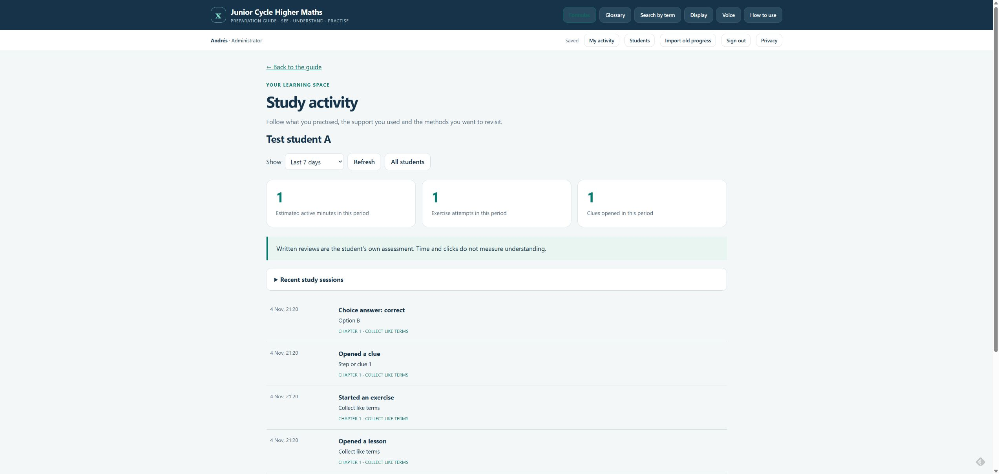
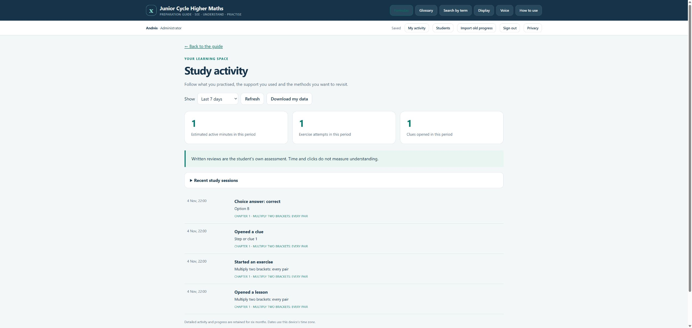

# Account pilot validation — 2026-11-04

Built and tested locally, then published to production on 2026-11-04 with explicit authorization.

## Passed

- `npm run build`: regenerated all 25 HTML pages and the server-side content catalog.
- `npm run test:accounts`: 17 tests. Signed Access JWT verification; invitation and
  role isolation; ten-account capacity; CSRF/origin checks; server-calculated choice
  answers; event deduplication; stale-progress protection; shared-browser account
  mismatch; content/time/ID bounds; active-time overlap and idle cutoff; calendar
  retention; suspension/deletion; explicit legacy import; paginated exports and
  activity; reset of a new attempt; malformed/oversized bodies; offline retry and
  logout draining multiple batches.
- Existing JavaScript suites: practice across 948 exercises, guided reading,
  search, speech, all 64 formula cards and contextual rule helpers.
- Existing Python checks: site validation (971 SVGs, 25 HTML files, 62 PDF pages),
  practice (99 independent answer checks), 320 intermediate working lines and
  44 published narration/content assertions.
- `python source/package.py`: rebuilt and verified the 27-file offline ZIP.
- `wrangler deploy --dry-run`: production Worker bundle compiled successfully,
  270.38 KiB / gzip 56.09 KiB. No upload or deployment.
- `git diff --check`: no whitespace errors.

## Browser checks in Chrome

Local development site: `http://127.0.0.1:8787/dev/login`.

- Student A's choice exercise, clue and lesson visits appeared in its activity.
- Student B had a separate empty history and no administrator controls.
- Sign out returned to the local test identity selector.
- Administrator could inspect Student A and return to the student list.
- A synthetic `invitation@example.test` invitation reserved a local place and
  displayed the prepared email link. No message was sent.
- A written practice exercise saved clue, revealed working and “solved with help”
  as distinct events, in temporal order.
- At a 390×844 viewport, the account toolbar and activity cards wrapped correctly;
  the student table scrolled inside its container without page overflow. Restored
  the original viewport afterwards.
- No browser console errors observed in these flows.

## Cloudflare setup verified

- Created EU-jurisdiction D1 database `junior-maths-activity`.
- Initialized the schema; verified the administrator row and `0001_accounts.sql`
  in the migration ledger using the dashboard console.
- Added One-time PIN identity provider.
- Created the six-hour `Junior Maths invited accounts` policy, currently allowing
  only the administrator's exact email. Attached to all live Worker traffic.

## Production activation

- Explicit authorization received for coordinated login activation and publication.
- Worker Access protects all traffic; sessions last six hours.
- Real application AUD saved; `npm run check:deploy` passes.
- Git production build configured for Node 24, build plus account tests, then `npm run deploy`.
- Preview branch builds are disabled.

- Commit `bf164ebe715777643730761e0c14c097b6a1ef9e` pushed to `main`.
- Cloudflare build `3ad1856f-2b89-4ffa-9b42-fdf78cc9a3c3` completed successfully
  with build and account tests; version `b760e1c9` receives 100% of traffic.
- Production bindings show `DB` linked to `junior-maths-activity` and the correct
  application origin, issuer and audience.
- Production cron confirmed: daily at 03:15 UTC.
- Anonymous browser visit redirected to Cloudflare Access email login.

- Administrator completed email verification; the guide shows `Andrés · Administrator`.
- Live smoke test: opened lesson 01-02, started an exercise, revealed its clue,
  and submitted option B (15). The server accepted the correct answer.
- Reloaded the live activity page: all four events persisted in time order;
  metrics showed one attempt and one clue. A second tab showed the same history.
- Students panel showed exactly one active admin account and nine remaining places.
- No browser console errors during the live account/activity flows.
- The original Access verification tab remained on its spinner after authentication;
  navigating directly to the app resolved it without another code.

No real student accounts or invitation messages were created during verification.
Production suspension/deletion and retention of aged records were not exercised
on real data; their behavior is covered by the local tests. The deployed daily
cron is confirmed, but its first scheduled execution has not yet occurred.
Invitations are sent manually using the prepared email; automated invitation
delivery is not configured.
